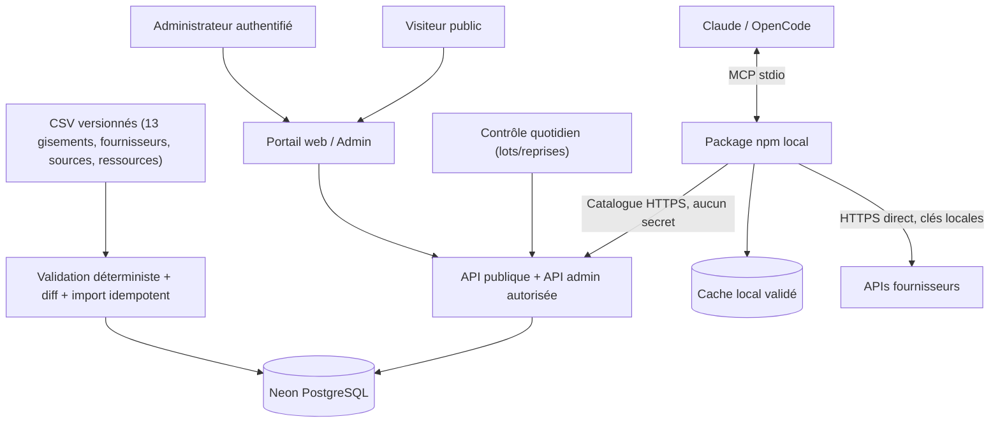

# World Data MCP — Architecture V1

**Statut :** proposition révisée; aucun code applicatif implémenté.

## Domaines et contrats
Gisement = taxonomie; fournisseur = organisation; source = point d'accès; ressource = dataset/service. Les contrats JSON déclaratifs sont indexés dans les CSV, validés par `schemaVersion`, et publiés par révision. API centrale de lecture versionnée; schéma OpenAPI à produire lors de l'implémentation.

## Sécurité
Validation stricte de l'origine des URLs et paramètres; défense SSRF/DNS rebinding/redirections; taille, timeout et quota; pas de code arbitraire. Secrets fournisseur locaux uniquement. Admin = session vérifiée et RBAC côté serveur, protection CSRF et audit; Vercel Deployment Protection ne suffit pas pour une route /admin sur un site public.

## Distribution
Monorepo envisagé `apps/portal`, `packages/mcp`, `packages/contracts`, `db/`, `data/reference/v1/`. Node LTS supportée, npx sans installation globale, SDK MCP stdio, SemVer npm séparé du `schemaVersion` des contrats et de la révision catalogue. GitHub Actions, publication npm OIDC sous approbation explicite.

## Exploitation
Vercel Hobby envisagé : cron quotidien par tâche avec déclenchement non précis; orchestrer par lots avec état persistant et reprise. Vérifier quotas de fonctions, durée et conditions d'usage avant déploiement. Neon avec branches preview isolées, migrations/CSV dry-run, production sur approbation.

## Arbitrages
Auth admin applicative; planificateur Hobby ou GitHub Actions/externe; fournisseur pilote; nom npm. Voir `docs/research/competitive-landscape.md` et `docs/research/vercel-hobby.md`.
