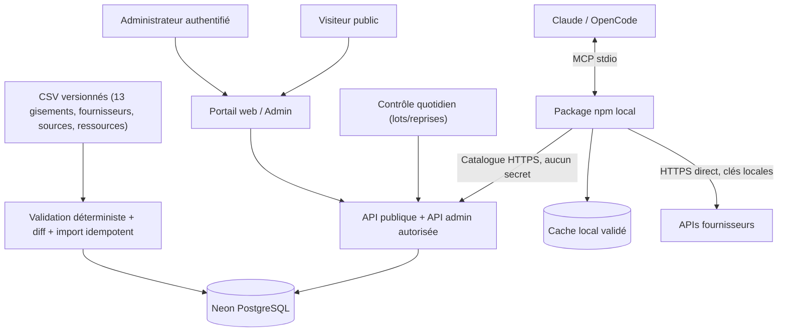

# World Data MCP — Architecture V1

**Statut :** proposition révisée; aucun code applicatif implémenté.

## Domaines et contrats
Gisement = taxonomie; fournisseur = organisation; source = point d'accès; ressource = dataset/service. Les contrats JSON déclaratifs sont indexés dans les CSV, validés par `schemaVersion`, et publiés par révision. API centrale de lecture versionnée; schéma OpenAPI à produire lors de l'implémentation.

## Sécurité
Validation stricte de l'origine des URLs et paramètres; défense SSRF/DNS rebinding/redirections; taille, timeout et quota; pas de code arbitraire. Secrets fournisseur locaux uniquement. Admin = session vérifiée et RBAC côté serveur, protection CSRF et audit; Vercel Deployment Protection ne suffit pas pour une route /admin sur un site public.

## Distribution
Monorepo envisagé `apps/portal`, `packages/mcp`, `packages/contracts`, `db/`, `data/reference/v1/`. Node LTS supportée, npx sans installation globale, SDK MCP stdio, SemVer npm séparé du `schemaVersion` des contrats et de la révision catalogue. GitHub Actions, publication npm OIDC sous approbation explicite.

## Exploitation
Vercel Hobby envisagé : cron quotidien par tâche avec déclenchement non précis; orchestrer par lots avec état persistant et reprise. Vérifier quotas de fonctions, durée et conditions d'usage avant déploiement. Neon avec branches preview isolées, migrations/CSV dry-run, production sur approbation.

## Décisions validées — 2026-11-23
- **Authentification applicative administrateur** : sessions sécurisées et autorisation serveur; fournisseur d'identité à sélectionner ultérieurement.
- **Vercel Cron Hobby quotidien** : contrôles bornés, persistants, idempotents, avec verrou anti-chevauchement et reprise; pas de promesse d'heure précise.
- **World Bank API** : premier fournisseur sans clé, contrat et ressource pilote à documenter; aucun appel fournisseur ne transite par le service central.
- **13 gisements** : taxonomie approuvée, initialisation obligatoire par CSV.

## Questions techniques ouvertes
Nom npm, mécanisme précis de session admin, endpoint/indicateur World Bank, vérification des limites et conditions Hobby. Voir `docs/research/competitive-landscape.md` et `docs/research/vercel-hobby.md`.

## Exigence impérative : Vercel Hobby
Concevoir le portail et les fonctions API dans les limites réelles de Hobby : exécutions courtes, pas de worker permanent, pas de fonctionnalité Pro obligatoire. Les contrôles quotidiens Vercel Cron utilisent des lots bornés, un état/cursor Neon et des reprises sur exécutions ultérieures. Le MCP reste local. Vérifier la durée et les quotas sur le projet réel avant validation de la V1; un dépassement exige une adaptation du design, pas un upgrade implicite. Vérifier aussi les conditions d'utilisation Hobby.
