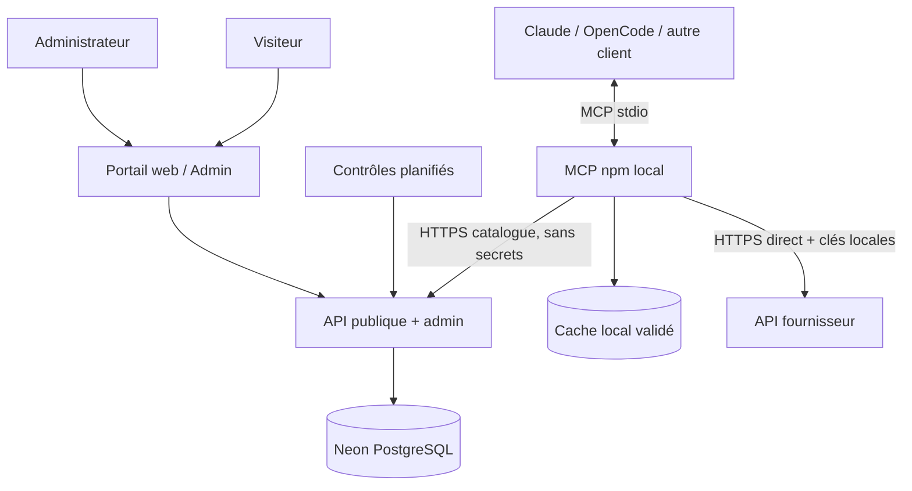

# World Data MCP — Architecture cible

**Statut :** proposition à valider avant implémentation.

## Composants

## Découpage
- **Portail** : présentation des gisements, recherche, fiches sources, administration protégée.
- **Service central** : API publique versionnée du catalogue, API admin authentifiée, validation et publication des contrats, état des vérifications.
- **MCP local** : SDK MCP officiel, stdio, découverte, validation stricte des contrats, cache TTL/stale, client HTTP sécurisé, gestion locale des secrets.
- **Stockage** : Neon pour référentiel et historique de vérifications; migrations et import de références versionnés.
- **Planification** : vérifier limites Vercel Hobby/cron avant de retenir le mécanisme; ne pas supposer un test quotidien garanti.

## Sécurité
- Contrats déclaratifs, version de schéma explicite, allowlist d'hôtes par source, blocage adresses privées et redirections non sûres, limites de taille/durée et quotas.
- Ne jamais journaliser ni transmettre les clés fournisseur à World Data MCP.
- Admin authentifié et autorisé côté serveur; API publique lecture seule.
- Séparer version SemVer du moteur, `schemaVersion` des contrats et révision du catalogue.

## Distribution
Monorepo proposé `apps/portal`, `packages/mcp`, `packages/contracts`, `db/`, `data/reference/`. Package npm public, releases GitHub, publication contrôlée avec OIDC/trusted publishing. Les changements de catalogue ne nécessitent pas de release npm.

## Points à instruire
Étude des MCP/catalogues concurrents; disponibilité du nom npm; auth admin sur Hobby; quotas/cron Vercel; tests de compatibilité clients; choix du premier fournisseur.
