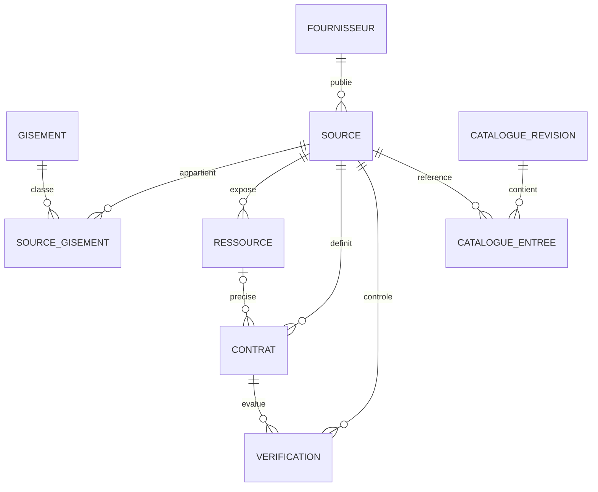

# World Data MCP — Modèle métier

**Statut :** cadrage V1, PR #1.

## Vocabulaire normatif
| Concept | Sens | Identité |
| --- | --- | --- |
| Gisement | Famille thématique de données, indépendante de l'organisation (ex. recherche scientifique) | `gisement_id` |
| Fournisseur | Organisation qui publie ou exploite des données/API (ex. INSEE) | `provider_id` |
| Source | Point d'accès ou ensemble identifié exposé par un fournisseur (ex. API statistiques) | `source_id` |
| Ressource | Jeu de données, collection, table, endpoint ou service particulier au sein d'une source | `resource_id` |
| Contrat | Description déclarative versionnée de l'accès à une source ou ressource | `contract_id`, `schema_version` |
| Vérification | Résultat horodaté d'un contrôle de disponibilité, conformité ou exploitabilité | `check_id` |
| Révision de catalogue | Instantané publié de données et contrats validés | `revision_id` |

Un gisement peut contenir plusieurs sources; une source peut appartenir à plusieurs gisements; un fournisseur peut publier plusieurs sources. Une ressource appartient à une source et peut posséder un contrat plus spécifique.

## Treize gisements obligatoires dès V1
1. Recherche scientifique
2. Jeux de données scientifiques
3. Intelligence artificielle et machine learning
4. Connaissances structurées
5. Web mondial
6. Actualité et événements
7. Finance et marchés
8. Blockchain et Web3
9. Entreprises et économie
10. Géospatial et environnement
11. Logiciel et cybersécurité
12. Culture et patrimoine
13. Données institutionnelles et gouvernementales

**Invariance V1 :** 13 lignes actives dans `gisements.csv`; aucune obligation d'avoir immédiatement une source fonctionnelle dans chacune. Enrichissement ultérieur = fournisseurs, sources, ressources et connecteurs.

## Relations

## Invariants
- Identifiants stables indépendants des libellés; relations validées avant publication.
- Aucun contrat ne contient de secret ou de code exécutable.
- Les données fournisseur transitent directement du fournisseur au MCP local.
- Une erreur de vérification ne détruit pas les données de catalogue.
- Les modifications administratives et données d'exploitation ne sont jamais écrasées par un import CSV standard.
