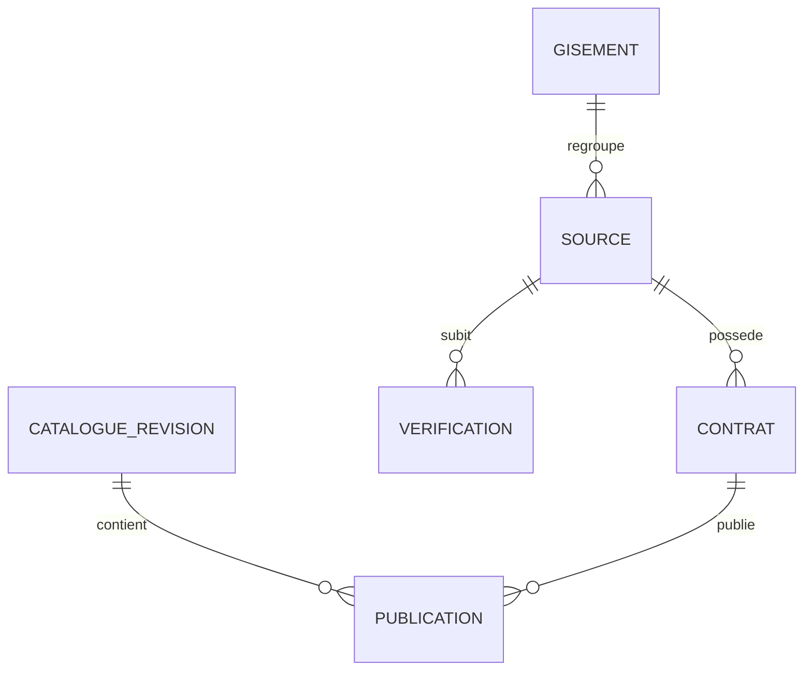

# World Data MCP — Modèle métier

**Statut :** proposition initiale.

| Concept | Définition |
| --- | --- |
| Gisement | Famille ou institution regroupant des sources (ex. INSEE, Eurostat). |
| Source | API ou jeu de données interrogeable, identifié par une clé stable. |
| Contrat d'accès | Définition déclarative versionnée de l'API, paramètres, auth, schémas, limites et origine autorisée. |
| Vérification | Exécution horodatée d'un test défini pour une source/contrat. |
| Publication | Révision validée du catalogue rendue accessible publiquement. |
| Catalogue | Ensemble publié des gisements, sources, contrats et métadonnées de qualité. |

## Cycle de vie
Brouillon → vérifié → publié → dégradé / retiré. Un test peut échouer sans entraîner une suppression immédiate; conserver l'historique et la date de dernière réussite.

## Invariants
- Chaque source a un identifiant stable, un gisement et un contrat compatible.
- Une source publiée doit indiquer provenance, conditions d'utilisation connues et date de vérification.
- Les contrats ne contiennent aucun secret utilisateur ni code exécutable.
- Une requête fournisseur est effectuée par le MCP local, pas par le service central.
- Les tests périodiques du service central utilisent uniquement des identifiants de test autorisés et ne collectent jamais les clés privées des utilisateurs.

## Relations proposées

Les cardinalités et états seront affinés avant migration SQL.
