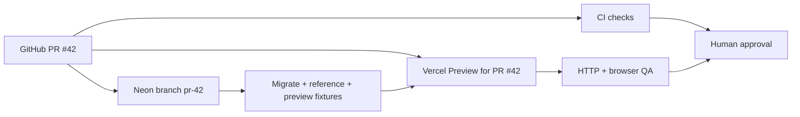

# End-to-end example — webapp with GitHub, Vercel and Neon

**Purpose:** show how **all eight skills** cooperate to deliver and operate a small application. This is an example, **not** a mandatory framework, folder layout, provider choice or preinstalled application. Agent can use its native capabilities and alternate tools. Do not perform writes or provisioning without the relevant approval.

## Example product

A simple shared reading list: visitors browse books, registered users add entries and mark them read. Product must first decide whether authentication is required, who owns records, privacy and moderation. A possible stack is React + TypeScript + Vite, Vercel Functions for HTTP APIs, Neon PostgreSQL. Alternative frameworks and providers remain valid.

| Phase | Lead skill | Collaborators | Verifiable output |
| --- | --- | --- | --- |
| Product discovery | `product` | `github` | Vision, domain glossary, journeys, acceptance criteria, roadmap issues |
| Architecture | `engineering` | `data-management` | Component diagram, API/OpenAPI, domain ERD, security model, ADR |
| GitHub setup | `github` | `engineering` | Main protection, PR template, CI, release policy |
| Platform setup | `neon`, `vercel` | `data-management` | Production DB/project, server-side secrets, environment map |
| Feature PR | `github` | `engineering`, `product` | Branch, code, tests, docs, PR with issue links |
| PR data and preview | `neon`, `vercel` | `data-management`, `github` | Isolated PR DB, migrated/imported fixtures, preview URL, API/UI QA |
| Merge/release | `github` | `vercel`, `neon`, `data-management` | Approved merge, approved version, prod migration/import, smoke tests |
| Ongoing operation | `automation` | `engineering`, `promotion` | Scheduled health/moderation/discovery reports and audit trail |

## 1. Define product and model

Invoke `product` to fill `docs/vision.md`, `docs/metier.md`, `docs/fonctionnel.md`, `docs/roadmap.md`. Example domain: `Book`, `ReadingEntry`, `User`; decide whether a book belongs to a shared catalogue while reading state belongs to an account. Capture unique identifiers and ownership rules. Invoke `data-management` for relational constraints and Mermaid ERD, not merely tables inferred from screens. Invoke `engineering` for `GET /api/books`, `POST /api/reading-entries`, validation, auth, error codes and an OpenAPI contract.

## 2. Establish GitHub governance

Invoke `github`: create a first milestone such as “M1 — browse and manage reading list”, then issues for browse, add, mark read and API/data work. Configure protected main, squash/PR title conventions, required CI, least-privilege Actions and issue/PR templates. Scope a coherent first PR and wait for implementation approval. Choose SemVer/Release Please separately from milestone numbering. Configure release triggers deliberately; never assume that a merge is technically isolated from Vercel production deployment.

## 3. Prepare database and deployment

Invoke `neon` to provision or inspect the authorized PostgreSQL project and identify production branch. Invoke `vercel` to provision/inspect project, Git integration, build, server-side env variables and production deployment gate. Verify the Git integration's **actual** main-branch auto-deploy behavior; if explicit production approval is mandatory, implement a real gate before proceeding.

Invoke `data-management` to establish distinct sources:

```text
data/
  reference/           # shared versioned catalogue/reference records
  seed/preview/        # disposable preview-only records
  seed/production/     # approved initial production records, if needed
db/migrations/         # versioned schema changes
```

This is a **suggested layout for the example**, not files included in v0. Do not version user-generated production records as seed.

Propose stack-specific scripts, for example:

```bash
npm run db:status -- --env preview
npm run db:init -- --env preview --dry-run
npm run db:migrate -- --env preview --apply
npm run db:import -- --env preview --dataset reference --apply
npm run db:import -- --env preview --dataset seed-preview --apply
npm run db:check -- --env preview
```

These are **illustrative contracts, not executable commands in this template**. The generated app must implement, document and test them. Destructive reset requires a separate explicit confirmation. Validate a fresh QA bootstrap and repeat imports to prove idempotence.

## 4. Implement PR and obtain working preview

After explicit approval, invoke `github` and `engineering` to create a branch, implement API/UI, tests and docs, and open PR. CI checks type/build/unit/API/docs/data where applicable.

For each PR affecting deployed behavior:



The diagram is a **target workflow**, not a claim of automatic provisioning. A PR branch must have a deterministic mapping to its own Neon branch and its Vercel deployment. A single shared `DATABASE_URL` for all previews defeats isolation. Prefer sanitized/schema-only branches when copying production data could expose personal records. Ensure teardown/retention policy on PR closure and consider costs.

The PR report should record actual preview URL, commit SHA, Neon branch, migration revision, dataset revision, CI results, HTTP checks and user-journey QA. A Vercel READY state alone is not sufficient.

## 5. Approve merge, then release

Only merge after explicit authorization. A successful CI or QA is not permission to merge. Release is a separate decision. Release Please can prepare a release PR/changelog/tag but does not inherently gate Vercel production. Confirm and enforce technical deploy behavior, including production alias promotion or controlled build as appropriate.

Before approved production release: verify backup/restore strategy, backward-compatible schema order, production runtime role permissions and approved reference/seed data. **Never import preview fixtures or reset runtime records in production.** Apply migrations/imports with explicit target and approval; deploy/promo app in a compatible order; run real HTTP smoke tests, inspect runtime logs and check data. A rollback of app code does not undo or safely restore newer user writes.

## 6. Operate with recurring agents

Invoke `automation` for recurring jobs with explicit owner, timezone, scope, read/write permissions, deduplication, failure handling and report destination:

- **Daily moderation** (if user-generated public content exists): inspect new submissions, flag suspicious content for human review; no unapproved deletions.
- **Daily technical checks**: errors, API health and abnormal data trends; propose an issue when justified.
- **Weekly promotion discovery** via `promotion`: research relevant public communities/conversations, assess relevance and prepare suggestions; no unsolicited publication without approval.
- **Weekly campaign results** via `promotion`: record verified posts, visits and feedback; unknown metrics stay unknown.

Choose scheduler according to task: GitHub Actions cron for deterministic checks, an available agentic scheduler for research/interpretation. This template **does not create or activate any recurring job**.

## Acceptance test

Ask at least two different agents to perform the same scenario using this template. Evaluate native problem-solving freedom, adherence to approval boundaries, PR isolation, repeatable data bootstrap, actual HTTP verification, release gating and recurring-task permissions. See [agent evaluation](../docs/operations/agent-evaluation.md).
